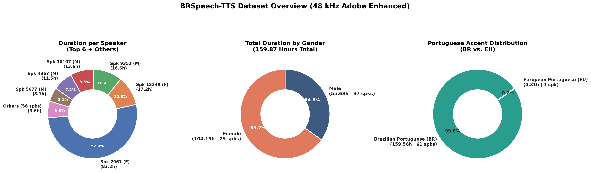
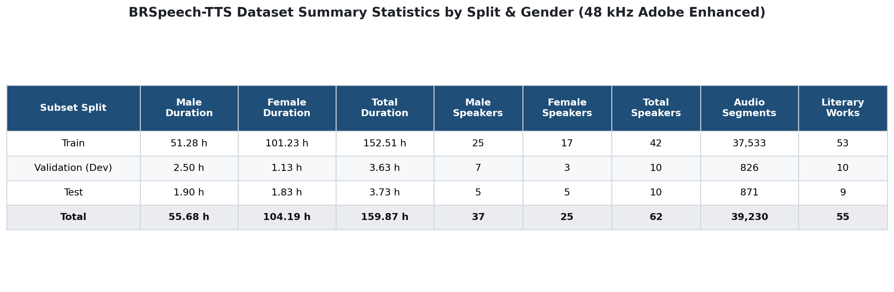
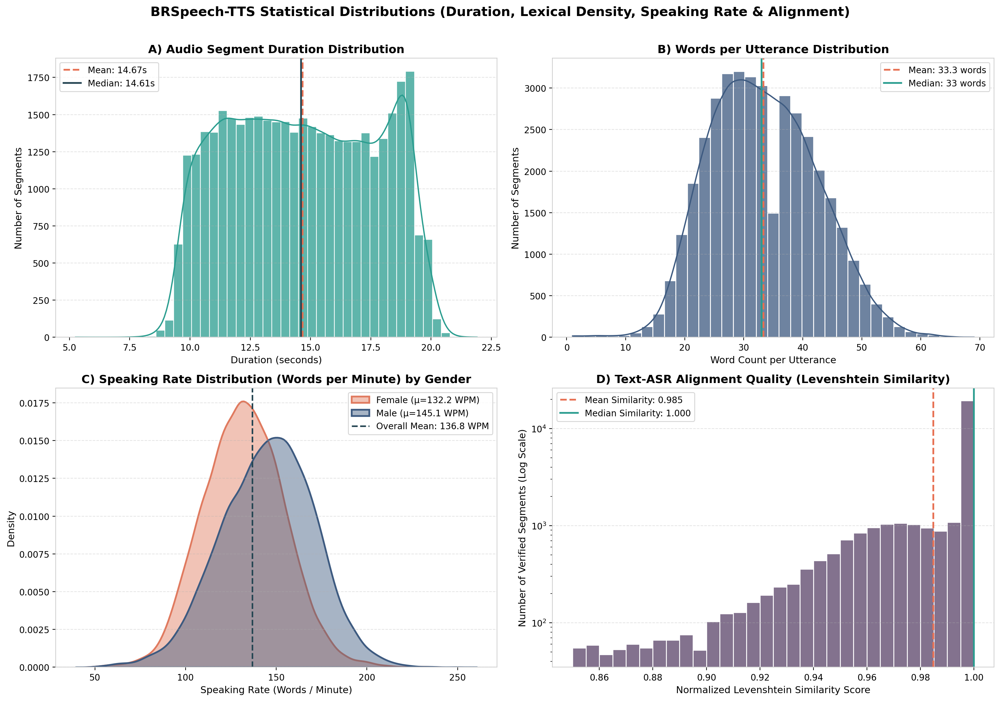
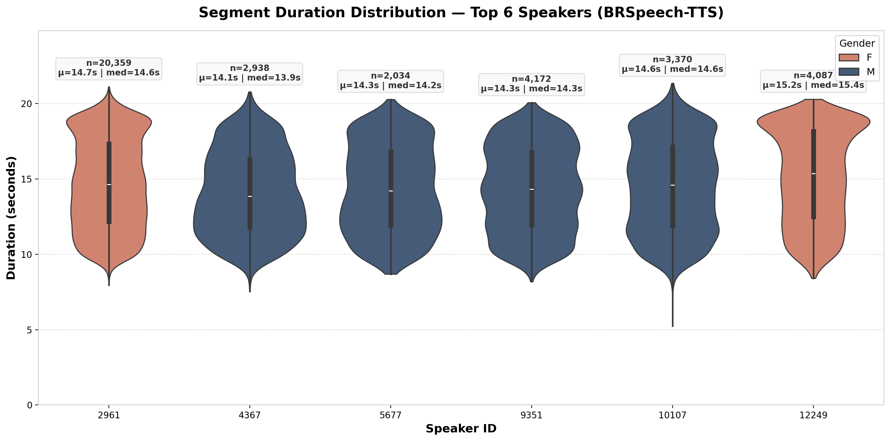
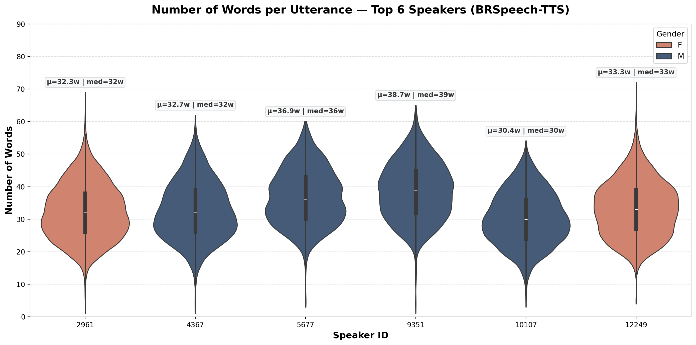
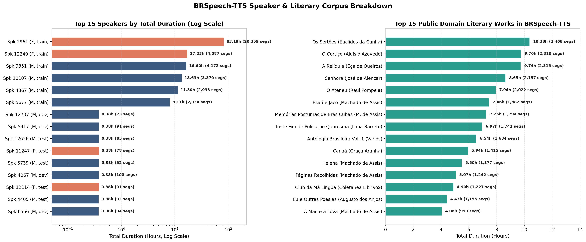

# BRSpeech-TTS: A High-Quality Dataset in Portuguese for Speech Synthesis

[](https://huggingface.co/datasets/freds0/BRSpeech-TTS/)
[](https://freds0.github.io/BRSpeech-Dataset/)
[](https://creativecommons.org/licenses/by/4.0/)

**BRSpeech-TTS** is a high-quality, multi-speaker dataset for training Text-to-Speech (TTS) and voice cloning models in Portuguese, developed at the [Center of Excellence in Artificial Intelligence (CEIA)](https://ceia.ufg.br/) of the Federal University of Goiás (UFG).

**BRSpeech-TTS is an enhanced version of the Portuguese subset of the CML-TTS dataset that underwent studio-grade speech enhancement via Adobe Podcast Enhance (Adobe Speech Enhancement).** All audio files were denoised, de-reverberated, and restored to a full-bandwidth sampling rate of **48 kHz** (compared to 24 kHz in the original CML-TTS dataset). Transcriptions were generated and verified using Automatic Speech Recognition (**OpenAI Whisper Large-v2** and **MMS**) and aligned against public-domain literary works from [Project Gutenberg](https://www.gutenberg.org/) and [LibriVox](https://librivox.org/).

The dataset is publicly available on the Hugging Face Hub at **[https://huggingface.co/datasets/freds0/BRSpeech-TTS/](https://huggingface.co/datasets/freds0/BRSpeech-TTS/)** under the **CC-BY 4.0** license.

---

## Download & Usage

### 1. Hugging Face Hub (Recommended)

You can download or stream **BRSpeech-TTS** directly from the [Hugging Face Hub (`freds0/BRSpeech-TTS`)](https://huggingface.co/datasets/freds0/BRSpeech-TTS/) using the `datasets` library:

```python
from datasets import load_dataset

# Load BRSpeech-TTS from Hugging Face Hub
dataset = load_dataset("freds0/BRSpeech-TTS")

print(dataset)
# DatasetDict({
#     train: Dataset({
#         features: ['wav_filename', 'duration', 'text', 'transcript', 'levenshtein',
#                    'speaker', 'file_size', 'num_words', 'gender', 'accent', 'audio'],
#         num_rows: 73848
#     })
#     validation: Dataset({features: [...], num_rows: 1158})
#     test: Dataset({features: [...], num_rows: 1316})
# })
```

### 2. Archive Downloads & Checksums

- **Hugging Face Dataset Repository:** [https://huggingface.co/datasets/freds0/BRSpeech-TTS/](https://huggingface.co/datasets/freds0/BRSpeech-TTS/)
- **OpenSLR Mirror (Original CML-TTS v0.1):** [http://www.openslr.org/146/](http://www.openslr.org/146/)
  - [CML-TTS Dataset Portuguese (`cml_tts_dataset_portuguese_v0.1.tar.bz`)](https://www.openslr.org/resources/146/cml_tts_dataset_portuguese_v0.1.tar.bz) — MD5: `8c877a4be0eb41f275497609df5a114c`
  - [CML-TTS Dataset Segments (`cml_tts_dataset_segments_v0.1.tar.bz`)](https://www.openslr.org/resources/146/cml_tts_dataset_segments_v0.1.tar.bz) — MD5: `f529a908aba26a6d891b4fb17ab3125b`

After downloading the enhanced BRSpeech-CML-TTS archive, verify its MD5 checksum:
```text
0966023cea9c0f339dae464d0fcfe7f8  BRSpeech_CML_TTS_v14012024.tar.bz
```

---

## Dataset Statistics

**BRSpeech-TTS** comprises audiobooks sourced from public-domain literary works on [Project Gutenberg](https://www.gutenberg.org/), narrated by volunteers from the [LibriVox](https://librivox.org/) project. It includes recordings in **Brazilian Portuguese (99.8%)** and **European Portuguese (0.2%)**, all enhanced with **Adobe Speech Enhancement** at a **48 kHz** sampling rate (`16-bit PCM Mono`).

### Key Highlights
- **Total Duration:** `159.87 hours` (`55.68 h` Male / `104.19 h` Female)
- **Total Speakers:** `62 speakers` (`37 Male` / `25 Female`; `61 BR` / `1 EU`)
- **Total Audio Segments:** `39,230` base FLAC files (`20.59 GB`), segmented into `76,322` utterances in the Hugging Face Hub Parquet release (`73,848` train / `1,158` validation / `1,316` test)
- **Public-Domain Books:** `55` classic literary works
- **Total Vocabulary Volume:** `1,306,913 words` (`7,606,434 characters`)
- **Audio Quality & Format:** `48 kHz`, `16-bit Mono`, enhanced via **Adobe Podcast Enhance**

### Split & Gender Breakdown

| Subset Split | Male Duration | Female Duration | Total Duration | Male Speakers | Female Speakers | Total Speakers | Base FLAC Segments | HF Hub Utterances | Books |
| :--- | :---: | :---: | :---: | :---: | :---: | :---: | :---: | :---: | :---: |
| **Train** | 51.28 h | 101.23 h | **152.51 h** | 25 | 17 | **42** | 37,533 | 73,848 | 53 |
| **Validation (Dev)** | 2.50 h | 1.13 h | **3.63 h** | 7 | 3 | **10** | 826 | 1,158 | 10 |
| **Test** | 1.90 h | 1.83 h | **3.73 h** | 5 | 5 | **10** | 871 | 1,316 | 9 |
| **Total** | **55.68 h (34.8%)** | **104.19 h (65.2%)** | **159.87 h (100%)** | **37 (59.7%)** | **25 (40.3%)** | **62 (100%)** | **39,230** | **76,322** | **55** |

### Acoustic, Lexical & Alignment Metrics

| Metric | Mean ± Std | Median | IQR (25% – 75%) | Min – Max |
| :--- | :---: | :---: | :---: | :---: |
| **Base Segment Duration (s)** | 14.67 ± 2.98 s | 14.61 s | 12.13 – 17.27 s | 5.26 – 21.91 s |
| **HF Sub-Segment Duration (s)** | 8.80 ± 4.46 s | 9.10 s | 4.64 – 12.80 s | 0.12 – 20.00 s |
| **Words per Base Segment** | 33.31 ± 8.99 words | 33.0 words | 27.0 – 40.0 words | 1 – 72 words |
| **Characters per Base Segment** | 193.89 ± 49.07 chars | 192.0 chars | 162.0 – 228.0 chars | 4 – 410 chars |
| **Speaking Rate (Words / Min)** | 136.69 ± 24.59 WPM | 136.46 WPM | 120.2 – 152.8 WPM | 40.0 – 260.0 WPM |
| **Levenshtein Alignment Similarity** | 0.9829 ± 0.021 | 1.0000 | 0.972 – 1.000 | 88.94% ≥ 0.95 (60.5% exact 1.0) |

### Top 6 Speakers Breakdown

| Speaker ID | Gender | Accent | Split | Duration (h) | Share (%) | Base Segments | Total Words | Books Read | Mean Duration |
| :---: | :---: | :---: | :---: | :---: | :---: | :---: | :---: | :---: | :---: |
| **2961** | Female (F) | BR | Train | **83.20 h** | 52.04% | 20,359 | 656,825 | 38 | 14.71 s |
| **12249** | Female (F) | BR | Train | **17.23 h** | 10.78% | 4,087 | 136,244 | 6 | 15.18 s |
| **9351** | Male (M) | BR | Train | **16.61 h** | 10.39% | 4,172 | 161,517 | 5 | 14.33 s |
| **10107** | Male (M) | BR | Train | **13.64 h** | 8.53% | 3,370 | 102,431 | 4 | 14.57 s |
| **4367** | Male (M) | BR | Train | **11.51 h** | 7.20% | 2,938 | 95,931 | 16 | 14.11 s |
| **5677** | Male (M) | BR | Train | **8.11 h** | 5.07% | 2,034 | 75,092 | 4 | 14.35 s |
| **Other 56 Speakers** | 33 M / 23 F | 55 BR / 1 EU | All | **9.57 h** | 5.99% | 2,270 | 78,873 | 31 | 15.18 s |

---

## Visualizations

### Dataset Overview (Speaker Share, Gender & Accent)


### Split & Gender Summary Table


### Acoustic, Lexical, Speaking Rate & Alignment Distributions


### Segment Duration & Word Count Distributions (Top 6 Speakers)




### Top 15 Speakers & Top 15 Public-Domain Literary Works


---

## Audio Samples

To listen to ground-truth samples from **BRSpeech-TTS** alongside samples synthesized by **YourTTS**, please visit our interactive demo page: **[https://freds0.github.io/BRSpeech-Dataset/](https://freds0.github.io/BRSpeech-Dataset/)**.

---

## Citation

If you use **BRSpeech-TTS** or **CML-TTS** in your research, please cite:

```bibtex
@InProceedings{Cmltts2023,
    title="CML-TTS: A Multilingual Dataset for Speech Synthesis in Low-Resource Languages",
    author="Oliveira, Frederico S. and Casanova, Edresson and Junior, Arnaldo Candido and Soares, Anderson S. and Galv{\~a}o Filho, Arlindo R.", 
    editor="Ek{\v{s}}tein, Kamil and P{\'a}rtl, Franti{\v{s}}ek and Konop{\'i}k, Miloslav",
    booktitle="Text, Speech, and Dialogue",
    year="2023",
    publisher="Springer Nature Switzerland",
    address="Cham",
    pages="188--199",
    isbn="978-3-031-40498-6"
}
```
